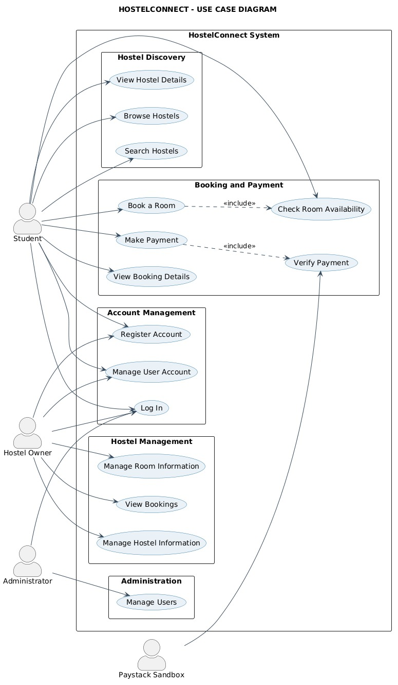
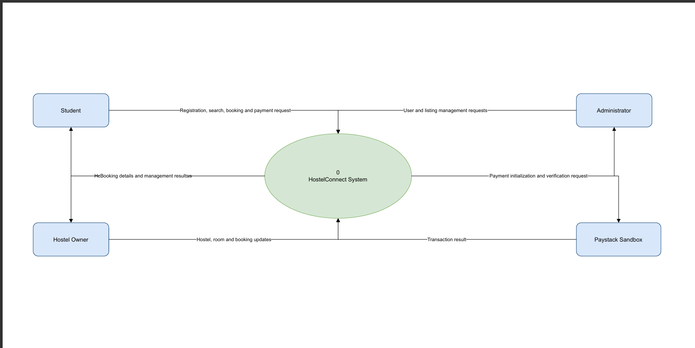
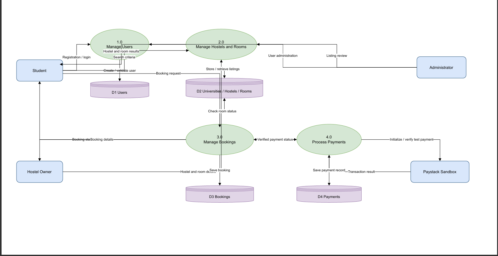
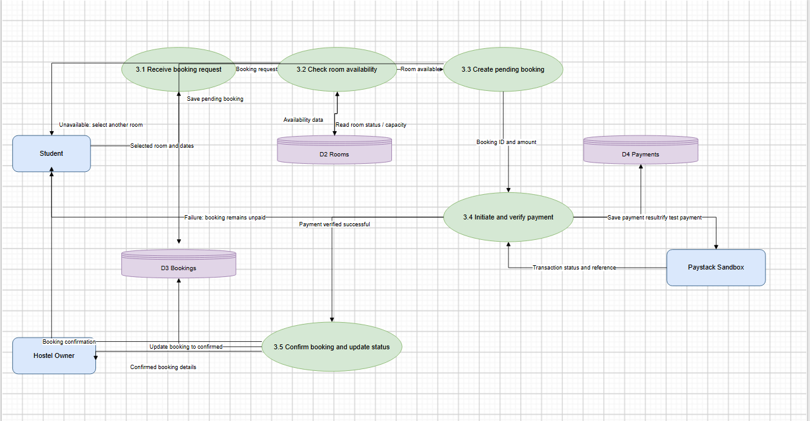
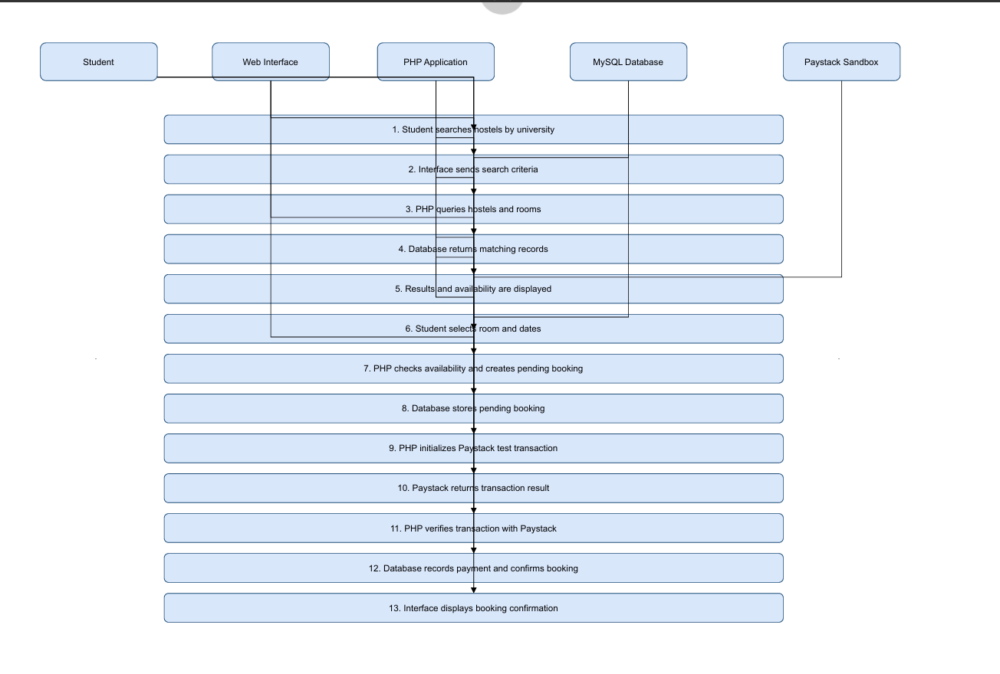
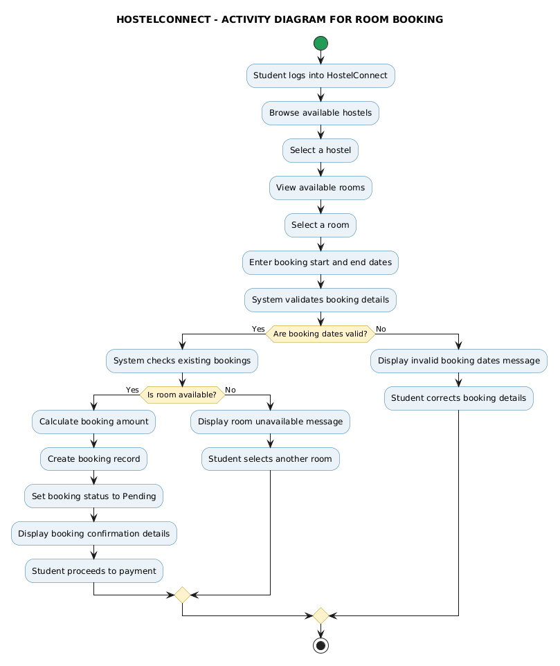

# HostelConnect

## Multi-University Student Hostel Booking System in Ghana

---

## 1. Project Overview

HostelConnect is a web-based system designed to help tertiary students discover and book private hostel accommodation around their universities.

The system connects students with hostel owners through a centralised accommodation platform.

## 2. Problem Being Solved

Students often experience difficulties finding suitable hostel accommodation, comparing prices and checking room availability.

The system seeks to simplify this process through online hostel discovery and room reservations.

## 3. Project Objectives

- Develop a user registration and authentication system.
- Enable students to search and view hostels.
- Allow students to check room availability.
- Implement an online room booking system.
- Integrate an external payment service.

## 4. Initial Project Coverage

The initial demonstration will cover:

- USTED
- KNUST
- Kumasi Technical University (KTU)

The system will support additional universities through its database design.

## 5. Core Features

1. User Management
2. Hostel Discovery
3. Room Booking
4. Payment and Booking Confirmation

## 6. User Categories

- Students
- Hostel Owners
- System Administrators

## 7. Technology Stack

| Component | Technology |
|---|---|
| Frontend | HTML, CSS, JavaScript |
| Backend | PHP |
| Database | MySQL |
| Server | XAMPP |
| External Service | Paystack Sandbox |
| Version Control | GitHub |
| Testing | PHPUnit |

## 8. Development Methodology

Agile Software Development Methodology.

## 9. Project Duration

Eight Weeks.

## 10. Project Team

Four Student Developers.

## 11. Project Status

Planning and Requirements Analysis.

---

# 12. System Diagrams

The following diagrams illustrate the analysis, structure, and workflows of HostelConnect.

## 12.1 Use Case Diagram

---

## 12.2 Context Diagram

---

## 12.3 Data Flow Diagram – Level 0

---

## 12.4 Data Flow Diagram – Level 1: Booking

---

## 12.5 Sequence Diagram

---

## 12.6 Activity Diagram

---